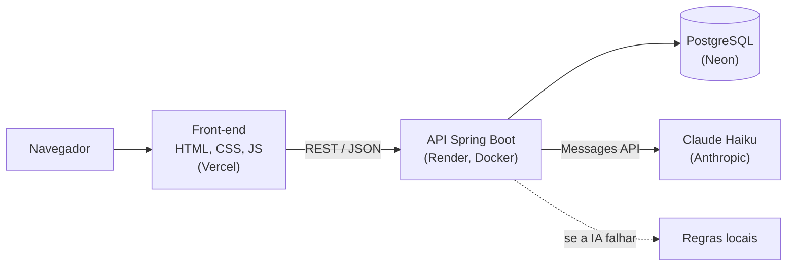
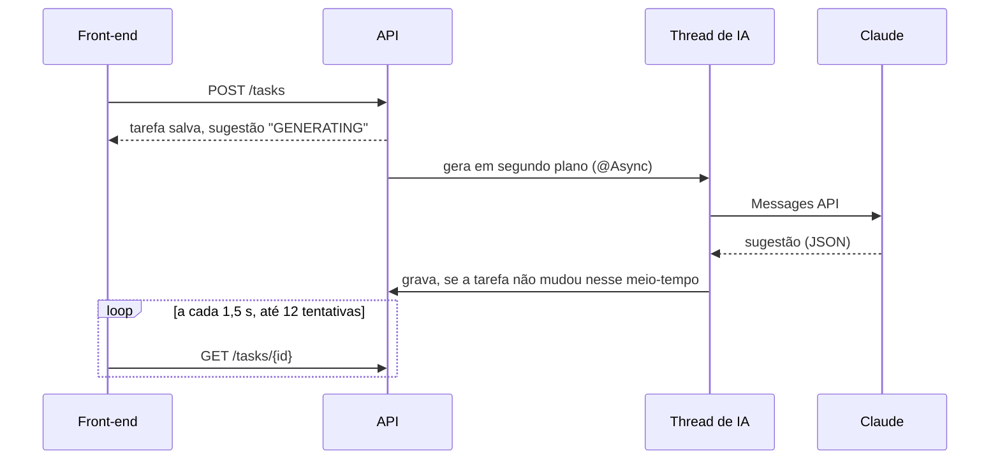

# FlowBoard

Gerenciador de tarefas full stack com IA integrada: você descreve a tarefa com suas palavras, o modelo preenche os campos, e cada tarefa salva recebe uma sugestão de próximos passos, gerada em segundo plano.

O projeto começou como desafio técnico para a XCL e evoluiu para um estudo de como integrar um LLM a uma aplicação real **sem que ela dependa dele**: se a IA falha, demora ou fica sem chave, o sistema continua funcionando com regras locais.

- **Aplicação:** https://flow-board-lovat.vercel.app
- **API (Swagger):** https://flowboard-backend-qnut.onrender.com/swagger-ui.html

> O back-end roda no plano gratuito do Render, que desliga o servidor após um tempo sem uso. A primeira requisição pode levar cerca de 50 segundos; a interface avisa enquanto espera. As seguintes respondem normalmente.

---

## O que ele faz

- **Criar tarefa a partir de texto livre.** "estudar árvores AVL pra prova de estrutura de dados quinta, urgente" vira título, categoria `Estudos`, prioridade `Alta` e prazo na próxima quinta. Os campos são preenchidos para revisão; nada é salvo sem o usuário confirmar.
- **Sugestão de próximos passos.** Ao salvar, a tarefa recebe uma dica curta, subtarefas e uma prioridade/categoria sugeridas. A interface mostra se a sugestão veio da **IA** ou das **regras**.
- **CRUD completo**, com conclusão/reabertura, filtros por status, prazo com destaque de atraso e um resumo do progresso.

## Arquitetura



| Camada | Tecnologias |
|---|---|
| Front-end | HTML, CSS e JavaScript puros, Lucide Icons |
| API | Java 17, Spring Boot 3.5, Spring Data JPA, Bean Validation, springdoc-openapi |
| Banco | PostgreSQL, migrações com Flyway |
| IA | API de Mensagens da Anthropic via `RestClient`, com structured outputs (JSON Schema) |
| Testes | JUnit 5, Mockito, MockMvc, Testcontainers |
| Entrega | GitHub Actions (CI), Docker, deploy automático no Render e na Vercel a cada push na `main` |

### Endpoints

| Método | Rota | Descrição |
|---|---|---|
| `GET` | `/tasks` | Lista as tarefas |
| `GET` | `/tasks/{id}` | Busca uma tarefa |
| `POST` | `/tasks` | Cria uma tarefa (a sugestão é gerada depois, em segundo plano) |
| `PUT` | `/tasks/{id}` | Atualiza uma tarefa |
| `PATCH` | `/tasks/{id}/toggle-status` | Alterna entre pendente e concluída |
| `DELETE` | `/tasks/{id}` | Exclui uma tarefa |
| `POST` | `/tasks/parse` | Converte texto livre em um rascunho de tarefa (não salva) |

A documentação interativa fica em `/swagger-ui.html`.

## Como a IA foi integrada

### 1. Fallback em todas as chamadas

Toda funcionalidade de IA passa por uma mesma regra ([`AiFallback`](backend/src/main/java/com/flowboard/backend/ai/AiFallback.java)): tenta o modelo e, se algo der errado, usa a implementação por regras. Os motivos de fallback são registrados em log:

- `ANTHROPIC_API_KEY` não configurada;
- timeout (10 s) ou erro de rede;
- erro HTTP da API (401, 429, 529…);
- resposta inválida: JSON quebrado, campo faltando ou valor fora dos enums.

Para quem chama, sempre volta um resultado válido. As duas implementações (IA e regras) seguem a mesma interface (`TaskAiAssistant`, `TaskParser`), e a versão "resiliente" que as combina é a injetada por padrão.

### 2. Saída estruturada e validada

As chamadas usam **structured outputs**: o pedido leva um JSON Schema e o modelo responde nesse formato. Mesmo assim, a resposta é validada no back-end antes de ser usada, e categorias e prioridades precisam bater com os enums do domínio. Os prompts ficam em arquivos ([`resources/prompts`](backend/src/main/resources/prompts)), fora do código Java.

### 3. Sugestão assíncrona

Uma chamada ao modelo leva de 1 a 3 segundos. Para o usuário não esperar isso ao salvar:



Detalhes que evitam bugs sutis:

- **Sugestão desatualizada:** antes de gravar, a thread confere se o título e a descrição ainda são os mesmos; se a tarefa foi editada durante a geração, a sugestão antiga é descartada.
- **Pool de threads pequeno** (2 a 4 threads, fila de 50) por causa da memória limitada do plano gratuito.
- **Desligamento gracioso:** num deploy, o servidor espera as gerações em andamento terminarem.

### 4. Controle de custo

O `POST /tasks/parse` chama o modelo a cada uso. Para evitar abuso, há um limite de requisições em memória com duas camadas: **10 por minuto por IP** e **60 por minuto no total**. O limite global existe porque o IP vem de um cabeçalho que o cliente pode falsificar. Acima do limite, a API responde `429` com `Retry-After`.

O modelo é o `claude-haiku-5-5`, o mais rápido e barato da família, adequado para tarefas curtas de extração.

## Avaliação da IA

Uma avaliação ([`ParseEvaluationTest`](backend/src/test/java/com/flowboard/backend/eval/ParseEvaluationTest.java)) roda o `POST /tasks/parse` contra 21 frases com resposta esperada ([`parse-cases.json`](backend/src/test/resources/eval/parse-cases.json)) e mede o acerto **por campo**, comparando a IA com as regras locais:

| Campo | IA | Regras (base de comparação) |
|---|---|---|
| Categoria | 20/20 (100%) | 14/20 (70%) |
| Prioridade | 14/14 (100%) | 8/14 (57%) |
| Prazo | 21/21 (100%) | 13/21 (62%) |
| Título | 20/20 (100%) | 9/20 (45%) |

Respostas válidas da IA: 21/21. Latência: mediana de 946 ms, máxima de 2,5 s.

**Limites desta medida:** são poucas frases, escritas por mim, e não um conjunto representativo de uso real; 100% aqui não significa que o modelo não erra. O valor da avaliação está em comparar com as regras e em detectar regressões quando o prompt ou o modelo mudam. Por depender de rede e custar créditos, ela fica fora do `mvn test` e do CI e só roda sob demanda.

## Decisões de engenharia

- **DTOs separados da entidade** (`TaskRequest`, `TaskResponse`): a API não expõe a entidade JPA, e mudanças no banco não quebram o contrato.
- **Validação com Bean Validation:** erros voltam como `400` com a mensagem de cada campo.
- **Enums persistidos como texto** (`@Enumerated(STRING)`): reordenar um enum não corrompe dados.
- **Flyway em vez de `ddl-auto=update`:** o esquema muda só por migrações versionadas. O Hibernate apenas valida se as entidades batem com o banco.
- **CORS restrito:** só as origens da variável `ALLOWED_ORIGINS` podem chamar a API pelo navegador.
- **Nenhum segredo no código:** senha do banco e chave da API vêm de variáveis de ambiente, e a chave nunca é impressa em log.
- **XSS:** todo texto vindo do usuário ou da IA é escapado antes de entrar no HTML.

## Testes

```bash
cd backend
./mvnw test
```

- **Unidade:** serviços, parsers, fallback, rate limiter, conversão de respostas do modelo.
- **Web (MockMvc):** validação, erros `400`/`429` e CORS.
- **Integração (Testcontainers):** sobe um PostgreSQL real em Docker e aplica as migrações do Flyway. Precisa do Docker em execução.
- **CI:** o GitHub Actions roda a suíte a cada push e pull request. Ele não tem a chave da API, então nunca chama o modelo.

Para rodar a avaliação da IA (exige `ANTHROPIC_API_KEY` na máquina e consome alguns centavos):

```bash
./mvnw test -Peval
```

O relatório é salvo em `backend/target/eval/parse-report.md`.

## Rodando localmente

**Requisitos:** Java 17 e PostgreSQL. O Docker só é necessário para os testes de integração.

1. Crie o banco `flowboard_db`. As tabelas são criadas pelo Flyway ao subir a aplicação.
2. Configure as variáveis de ambiente:

   | Variável | Obrigatória | Padrão |
   |---|---|---|
   | `DATABASE_PASSWORD` | sim | (vazia) |
   | `DATABASE_URL` | não | `jdbc:postgresql://localhost:5432/flowboard_db` |
   | `DATABASE_USERNAME` | não | `postgres` |
   | `ANTHROPIC_API_KEY` | não | sem chave, tudo funciona com as regras locais |
   | `ALLOWED_ORIGINS` | não | `http://localhost:5500,http://127.0.0.1:5500` |

3. Suba a API:

   ```bash
   cd backend
   ./mvnw spring-boot:run
   ```

   Ela fica em `http://localhost:8080`, com o Swagger em `http://localhost:8080/swagger-ui.html`.

4. Abra o `frontend/index.html` com o Live Server do VS Code (porta 5500). O front aponta para a API publicada; para usar a API local, troque o `API_URL` em [`frontend/js/api.js`](frontend/js/api.js) para `http://localhost:8080/tasks`.

## Estrutura

```
FlowBoard
├── backend
│   └── src
│       ├── main
│       │   ├── java/com/flowboard/backend
│       │   │   ├── ai           # cliente da Anthropic, prompts, fallback e regras
│       │   │   ├── config       # CORS e OpenAPI
│       │   │   ├── controller   # rotas REST
│       │   │   ├── dto          # contrato da API
│       │   │   ├── exception    # tratamento global de erros
│       │   │   ├── model        # entidade e enums
│       │   │   ├── ratelimit    # limite de requisições
│       │   │   ├── repository
│       │   │   └── service
│       │   └── resources
│       │       ├── db/migration # migrações do Flyway
│       │       └── prompts      # prompts do sistema
│       └── test                 # unidade, web, integração e avaliação
└── frontend
    ├── assets/brand             # logo e isotipo
    ├── css
    ├── js
    └── index.html
```

## Limitações conhecidas

- **Partida a frio de cerca de 50 s** no plano gratuito do Render.
- **Sem autenticação:** todas as tarefas são compartilhadas. Por isso também não há dados pessoais.
- **Rate limit em memória:** suficiente para uma instância; com várias, os contadores precisariam ficar num armazenamento compartilhado (ex.: Redis).
- **A sugestão é consultada por polling.** Server-Sent Events evitariam as consultas repetidas, mas o polling é mais simples e suficiente no volume atual.
- **O Swagger fica aberto em produção** de propósito, para facilitar a avaliação do projeto.

## Autor

João Pedro Maiorano · [GitHub](https://github.com/Maioranoo) · [LinkedIn](https://www.linkedin.com/in/jo%C3%A3o-pedro-maiorano-28a10a3b8/)
